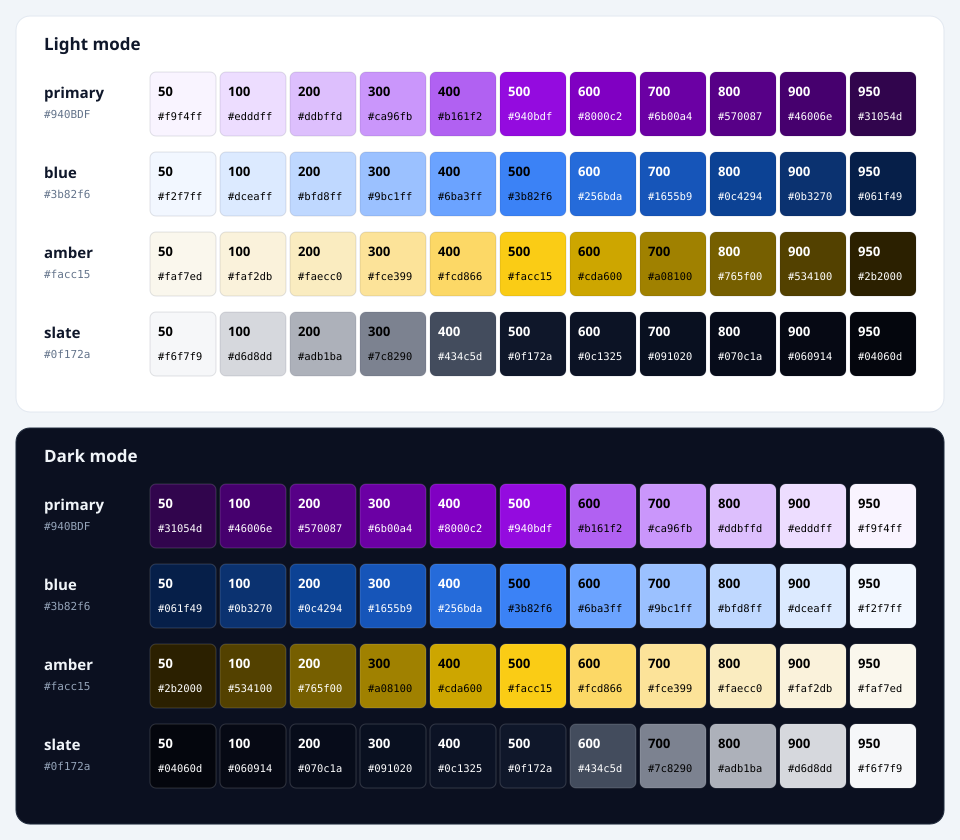

# tailwindcss-custom-colors

One color in, a complete Tailwind CSS 4 theme out: an OKLCH shade scale, a dark
scale, a contrast color, all behind CSS variables you can swap at runtime.

[Try it live](https://quentinjuarez.github.io/tailwindcss-custom-colors/)



[](https://www.npmjs.com/package/tailwindcss-custom-colors)
[](https://www.npmjs.com/package/tailwindcss-custom-colors)
[](LICENSE)

- [Why](#why)
- [Installation](#installation)
- [Quick start](#quick-start)
- [CLI](#cli)
- [Generated output](#generated-output)
- [Formats and CI](#formats-and-ci)
- [Vite plugin](#vite-plugin)
- [Accepted input](#accepted-input)
- [Gamut](#gamut)
- [Dark mode](#dark-mode)
- [Runtime kit](#runtime-kit)
- [Semantic colors](#semantic-colors)
- [Harmony](#harmony)
- [Contrast](#contrast)
  - [APCA, targets and on-colors](#apca-targets-and-on-colors)
- [API](#api)
- [Server rendering](#server-rendering)
- [Limits](#limits)
- [Upgrading from 1.x](#upgrading-from-1x)
- [Development](#development)
- [Releasing](#releasing)
- [License](#license)

## Why

Some apps do not know their brand color at build time: white label products,
one theme per tenant, a color the user picks. Tailwind 4 can already mix any
CSS variable, but it cannot turn one color into a full scale for you.

You give `createTheme` one color per name. It gives you back:

- `primary-50` to `primary-950` plus `primary-contrast`, as Tailwind utilities
  (`bg-primary-500`, `text-primary-contrast`, `bg-primary-500/50`, and so on);
- the CSS variables behind them, for light and dark mode;
- an `apply()` to swap the whole theme in the browser without a rebuild;
- the computed values as data (OKLCH and hex), for charts, emails or canvas.

Shades are computed in OKLCH, so scales look even across hues. Your input color
is exactly step `500`. Zero runtime dependency.

## Installation

```bash
npm install tailwindcss-custom-colors
# or
yarn add tailwindcss-custom-colors
```

Requires Tailwind CSS 4 and Node.js 22 or later (the CLI needs it too). For
Tailwind 3, stay on 1.x (see [MIGRATION.md](MIGRATION.md)).

## Quick start

Build the theme and write its `css` to a stylesheet, for example in a build
script:

```js
import { writeFileSync } from 'node:fs';

import { createTheme } from 'tailwindcss-custom-colors';

writeFileSync('src/theme.css', createTheme({ primary: '#940BDF' }).css);
```

Import it after Tailwind:

```css
@import 'tailwindcss';
@import './theme.css';
```

Use the utilities:

```html
<button class="bg-primary-500 text-primary-contrast hover:bg-primary-600">
  Save
</button>
```

Swap the theme at runtime, with no rebuild:

```js
createTheme({ primary: '#0B6FDF' }).apply();
```

`apply()` rewrites the CSS variables on `document.documentElement`, so every
`bg-primary-500` on the page follows. The color names must be the ones the
stylesheet was built with, since Tailwind only generates utilities for those.

Both `import` and `require` work:

```js
const { createTheme } = require('tailwindcss-custom-colors');
```

> [!IMPORTANT]
> Dark mode is on by default (`dark: 'media'`). When the OS prefers dark, the
> shades are mirrored: `50` becomes the dark end and `950` the light end. A
> light only app must pass `{ dark: false }`.
>
> `apply()` pins one mode with inline variables, and they beat the stylesheet.
> An app that follows the OS must call `apply(element, 'dark')` itself when
> needed. See [Dark mode](#dark-mode).

## CLI

No script needed if the colors are known at build time:

```bash
npx tailwindcss-custom-colors primary=#940BDF > theme.css
npx tailwindcss-custom-colors primary=#940BDF accent=#FFD534 --dark class > theme.css
```

Then import it:

```css
@import 'tailwindcss';
@import './theme.css';
```

| Flag              | What it does                                                                             |
| ----------------- | ---------------------------------------------------------------------------------------- |
| `--dark media`    | Dark variables under `prefers-color-scheme: dark` (default)                              |
| `--dark class`    | Dark variables under a `.dark` selector                                                  |
| `--dark none`     | No dark variables                                                                        |
| `--gamut p3`      | Keep Display P3 colors, `srgb` is the default                                            |
| `--contrast apca` | Pick on-colors with APCA instead of WCAG, see [Contrast](#contrast)                      |
| `--target AAA`    | Pass threshold used by `--report`: `AA` (default), `AAA` or a number                     |
| `--on`            | Also emit one on-color variable per step                                                 |
| `--neutral`       | Add a tinted `neutral` scale, see [Semantic colors](#semantic-colors)                    |
| `--status`        | Add `success`, `warning`, `danger` and `info` scales                                     |
| `--harmony`       | Derive `secondary` and `tertiary` colors, see [Harmony](#harmony)                        |
| `--seed 3`        | With `--harmony`, pick another palette: a number or any text                             |
| `--roles`         | Add the `surface`, `on-surface`, `border` and `muted` variables                          |
| `--format json`   | Print `css` (default), `json`, `scss` or `tokens`, see [Formats and CI](#formats-and-ci) |
| `--out theme.css` | Write the output to a file instead of stdout                                             |
| `--check`         | With `--out`, exit 1 when the file is out of date                                        |
| `--report`        | Print a contrast report table instead of CSS                                             |
| `--help`          | Show the usage                                                                           |

On invalid input the CLI prints a one line error to stderr and exits with
code 1.

## Generated output

`npx tailwindcss-custom-colors primary=#940BDF` prints this (trimmed, the
omitted steps follow the same pattern):

<!-- prettier-ignore -->
```css
:root {
  --primary-50: oklch(0.9750 0.0150 306.79);
  --primary-100: oklch(0.9213 0.0480 306.79);
  /* 200 to 400 */
  --primary-500: oklch(0.5277 0.2669 306.79);
  /* 600 to 900 */
  --primary-950: oklch(0.2500 0.1201 306.79);
  --primary-contrast: #ffffff;
}

@media (prefers-color-scheme: dark) {
  :root {
    --primary-50: oklch(0.2500 0.1201 306.79);
    /* 100 to 400 */
    --primary-500: oklch(0.5277 0.2669 306.79);
    /* 600 to 900 */
    --primary-950: oklch(0.9750 0.0150 306.79);
    --primary-contrast: #ffffff;
  }
}

@theme inline {
  --color-primary-50: var(--primary-50);
  /* 100 to 900 */
  --color-primary-950: var(--primary-950);
  --color-primary-contrast: var(--primary-contrast);
}
```

Three blocks:

- `:root` holds the light values. Steps are `50`, `100` to `900`, and `950`.
- The dark block mirrors the light scale: dark step `s` takes the value of
  light step `1000 - s`, so `50` becomes the darkest shade and `500` does not
  change.
- `@theme inline` registers the Tailwind tokens. They point at the variables
  instead of holding values, which is what makes the runtime swap work. The
  opacity modifier (`bg-primary-500/50`) works through Tailwind's
  `color-mix()`.

Variables hold `oklch()` values with no fallback. If you target a browser
without OKLCH support, use the `hex` values from `theme.scales`.

## Formats and CI

`--format` picks what the CLI prints. `css` is the default.

| Format   | Output                                                                                                  |
| -------- | ------------------------------------------------------------------------------------------------------- |
| `css`    | The stylesheet from [Generated output](#generated-output)                                               |
| `json`   | `{ "light": { "--primary-50": "oklch(...)" }, "dark": { ... } }`                                        |
| `scss`   | Two maps, `$theme-light` and `$theme-dark`, with keys such as `"primary-50"`                            |
| `tokens` | Design tokens: `{ "primary": { "50": { "$type": "color", "$value": { "colorSpace": "srgb", ... } } } }` |

`dark` is left out of `json`, `scss` and `tokens` with `--dark none`. The
`tokens` format follows the stable Design Tokens format (2025.10): each step and
the contrast color is an sRGB color object with `components` and `hex`, and the
dark hex sits under `$extensions["tailwindcss-custom-colors"].dark`. It carries
neither wide gamut precision nor the roles and on-colors: use `json` for those.

`--out` writes the file, creates missing folders and prints nothing:

```bash
npx tailwindcss-custom-colors primary=#940BDF --out src/theme.css
```

`--check` compares the output with the file and never writes. It exits with 0
when they match and with 1 otherwise, so a CI step can catch a stale file:

```bash
npx tailwindcss-custom-colors primary=#940BDF --out src/theme.css --check
```

The comparison is exact, line endings included. `--report` cannot be combined
with `--format`, and a blank `--out` path is rejected.

## Vite plugin

With Vite, skip the file and the CLI: the plugin generates the theme for you.
It does not import Vite, so it adds no dependency, and it is tested with
Vite 8.

```ts
// vite.config.ts
import tailwindcss from '@tailwindcss/vite';
import { customColors } from 'tailwindcss-custom-colors/vite';
import { defineConfig } from 'vite';

export default defineConfig({
  plugins: [customColors({ colors: { primary: '#940BDF' } }), tailwindcss()],
});
```

```css
@import 'tailwindcss';
@import 'virtual:theme.css';
```

List `customColors` before `tailwindcss()`: Tailwind resolves imports itself and
cannot find `virtual:theme.css` otherwise. Every `ThemeOptions` option works
next to `colors` (`dark`, `gamut`, `contrast`, `neutral`, `status`, `roles`).

`colors` can also be the path of a JSON file, relative to the Vite root:

```ts
customColors({ colors: 'theme-colors.json', dark: 'class' });
```

```json
{ "primary": "#940BDF", "accent": "#FFD534" }
```

The file is watched. Saving it updates the styles in the running dev server,
with no restart. An invalid file reports a one line error.

The plugin writes the generated CSS to a file in
`tailwindcss-custom-colors/` inside Vite's cache directory and points the import
at it, so there is nothing to commit. Media and layer conditions after the
import are kept, as in `@import 'virtual:theme.css' layer(theme);`. A plain `import 'virtual:theme.css'` in a JavaScript file also works,
and serves the same CSS as a style module.

The import is rewritten only in CSS files that Vite itself transforms: your
entry stylesheet, and style blocks of single file components. Tailwind reads
files that it follows through `@import` or `@reference` on its own, so the
line cannot live in such a file. For those, generate a real file with the
[CLI](#formats-and-ci) instead.

Errors are one line each:

- `customColors expects an options object`
- `customColors needs a colors option (an object or a path to a JSON file)`
- `Cannot read colors file <path>: <reason>`
- `Invalid colors file <path>: <reason>`

The types `CustomColorsOptions` and `VitePlugin` are exported from
`tailwindcss-custom-colors/vite`.

## Accepted input

| Format       | Examples                                                        |
| ------------ | --------------------------------------------------------------- |
| Hex          | `#940BDF`, `940bdf`, `#94d`, `#94df`, `#940BDF80`               |
| Named colors | `rebeccapurple`, `teal`                                         |
| `rgb()`      | `rgb(148 11 223)`, `rgba(148, 11, 223, 0.5)`, `rgb(58% 4% 87%)` |
| `hsl()`      | `hsl(279 91% 46%)`, `hsla(279deg, 91%, 46%, 1)`                 |
| `hwb()`      | `hwb(279 4% 13%)`                                               |
| `lab()`      | `lab(40% 70 -80)` (D50)                                         |
| `lch()`      | `lch(40% 100 300)` (D50)                                        |
| `oklab()`    | `oklab(0.53 0.1 -0.2)`                                          |
| `oklch()`    | `oklch(0.53 0.27 306.8)`, `oklch(53% 0.27 307)`                 |
| `color()`    | `color(display-p3 0 1 0)`, `color(xyz-d65 0.3 0.2 0.4)`         |

- `color()` channels accept percentages (`color(srgb 50% 0% 100%)`). Spaces: `srgb`, `srgb-linear`, `display-p3`, `a98-rgb`,
  `prophoto-rgb`, `rec2020`, `xyz`, `xyz-d50` and `xyz-d65`.
- Modern (space separated) and legacy (comma separated) syntaxes both work
  for `rgb()` and `hsl()`.
- Hue accepts `deg`, `grad`, `rad` and `turn`, or no unit. Negative hues and
  hues above 360 wrap around.
- `none` stands for 0 wherever a number is accepted.
- Hex works with 3, 4, 6 or 8 digits, with or without `#`.
- Alpha is parsed and ignored: a theme color is opaque. Use the opacity
  modifier (`/50`) instead.
- Every color is clamped into the chosen [gamut](#gamut), sRGB by default. The
  `hex` values are always clamped to sRGB.
- Color names follow `/^[\p{L}\p{N}_-]+$/u` (letters, digits, `_` and `-`, any
  script). `__proto__`, `constructor` and `prototype` are rejected.

Invalid input throws an `Error` with a one line message that names the color
and gives the reason in parentheses:

```text
Invalid color: nope (unknown color name)
Invalid color: color(foo 1 2 3) (unknown color space: foo)
```

## Gamut

By default every color is clamped into sRGB. With `gamut: 'p3'`, colors from
the wider Display P3 gamut keep their saturation, and the generated steps can
also use P3 chroma, even for sRGB inputs:

```js
createTheme({ vivid: 'color(display-p3 0 1 0)' }, { gamut: 'p3' });
```

```bash
npx tailwindcss-custom-colors vivid='color(display-p3 0 1 0)' --gamut p3
```

With `gamut: 'p3'` the `oklch` CSS values may lie outside sRGB, and browsers
render them on a wide gamut display. The `hex` values stay sRGB: they are the
clamped fallback. The `contrast` color and `ratio` are computed on that
fallback, see [Contrast](#contrast). The default `'srgb'` output is unchanged
from 2.0.

## Dark mode

Pick a strategy with the `dark` option (`--dark` on the CLI):

| Option            | Dark variables go under                         |
| ----------------- | ----------------------------------------------- |
| `'media'` default | `@media (prefers-color-scheme: dark) { :root }` |
| `'class'`         | `.dark`                                         |
| `false`           | nowhere, light only                             |

```js
createTheme({ primary: '#940BDF' }, { dark: 'class' });
```

Because the dark values live in the same variables, `bg-primary-500` adapts on
its own. You do not need `dark:` variants for theme colors.

`apply(element, 'dark')` writes the dark values as inline styles on the
element. Inline variables beat the stylesheet, so a forced dark `apply` wins
over the media query and the `.dark` class. The same holds for
`apply(element, 'light')`: once `apply` has run on an element, the stylesheet
no longer switches its variables. `apply` does not toggle a class and does not
read `prefers-color-scheme`: for a light, dark or system switch that
remembers the choice, see the [runtime kit](#runtime-kit).

## Runtime kit

A small opt-in module for the browser: switch between light, dark and system,
remember the choice and avoid a flash on first paint. It has no dependency and
lives behind its own entry point, so it costs nothing unless you import it.

It toggles the `dark` class and the `color-scheme` property on `<html>`, so it
needs `dark: 'class'`. With `'media'` the OS decides and a class cannot force a
mode. Tailwind 4 needs this line once to make `dark:` utilities follow the
class:

```css
@custom-variant dark (&:where(.dark, .dark *));
```

```js
import {
  applyScheme,
  persist,
  watchScheme,
} from 'tailwindcss-custom-colors/runtime';

const store = persist();
applyScheme(store.get());

watchScheme(() => {
  if (store.get() === 'system') applyScheme('system');
});

button.onclick = () => {
  store.set('dark');
  applyScheme('dark');
};
```

To avoid a flash before your bundle loads, inline the script in `<head>`,
before the stylesheet. It runs the same logic as `applyScheme(persist(key).get())`
and never throws:

```js
import { themeScript } from 'tailwindcss-custom-colors/runtime';

const head = `<script>${themeScript()}</script>`;
```

| Function                  | What it does                                                                                                                  |
| ------------------------- | ----------------------------------------------------------------------------------------------------------------------------- |
| `applyScheme(scheme, el)` | Applies `'light'`, `'dark'` or `'system'` to `el` (default `<html>`) and returns the resolved mode. `'system'` reads the OS.  |
| `watchScheme(onChange)`   | Calls `onChange('dark' \| 'light')` when the OS preference changes. Returns a function that stops listening.                  |
| `persist(key)`            | Returns `{ get, set }` backed by `localStorage` (default key `'theme'`). `get` falls back to `'system'` when storage fails.   |
| `themeScript(key)`        | Returns the inline script for `<head>`. The key may only contain letters, digits, `_`, `.`, `:` and `-`, up to 64 characters. |

Do not mix it with `theme.apply(el, 'dark')`: inline variables beat the class.
Without `matchMedia` (Node, old browsers), `'system'` means light and
`watchScheme` does nothing.

## Semantic colors

Three opt-in options derive more colors from the ones you pass. Each extra
scale goes through the same engine, so it has a dark mirror, a contrast color,
the `contrast` options and its own rows in `report()`.

```js
createTheme(
  { primary: '#0B6FDF' },
  { neutral: 'auto', status: true, roles: true },
);
```

| Option            | Adds                                                                                     |
| ----------------- | ---------------------------------------------------------------------------------------- |
| `neutral: 'auto'` | A `neutral` scale tinted with the hue of your first color, with a chroma of at most 0.02 |
| `status: true`    | `success`, `warning`, `danger` and `info`, from fixed hues (145, 85, 27 and 250)         |
| `roles: true`     | Four variables for the common cases, and it adds `neutral` when you have none            |

The roles point at neutral steps, so the dark mirror switches them with no
extra value:

| Role       | Variable       | Value                | Utility           |
| ---------- | -------------- | -------------------- | ----------------- |
| Background | `--surface`    | `var(--neutral-50)`  | `bg-surface`      |
| Text       | `--on-surface` | `var(--neutral-950)` | `text-on-surface` |
| Dividers   | `--border`     | `var(--neutral-200)` | `border-border`   |
| Quiet text | `--muted`      | `var(--neutral-600)` | `text-muted`      |

```html
<div class="bg-surface text-on-surface border border-border">
  <p class="text-muted">Same markup in light and dark.</p>
</div>
```

With the derived neutral, `muted` over `surface` reaches 4.5:1 in light and
dark for any hue. That guarantee does not hold for a `neutral` you pass
yourself.

The derived scale is registered as `--color-neutral-*`, which replaces
Tailwind's built-in `neutral` palette for the whole app. The role names
`--border` and `--muted` are plain variables, so they can clash with a UI kit
that uses the same names.

A color you define yourself always wins. If you pass a color named `neutral`,
`success`, `warning`, `danger` or `info`, it is kept as is and the derived one is
skipped. The roles then use your `neutral`.

## Harmony

`harmony: true` derives two more colors from your first one, named `secondary`
and `tertiary`, so a single brand color gives a palette that reads as designed.

```js
createTheme({ primary: '#0B6FDF' }, { harmony: true });
```

Each color has its own role, and the three are staged in lightness, from deep
to mid to light, instead of three flat blocks of the same weight:

| Your color is                | `secondary` is | `tertiary` is |
| ---------------------------- | -------------- | ------------- |
| mid (lightness 0.45 to 0.72) | deep           | light         |
| dark (lightness under 0.45)  | mid            | light         |
| light (lightness over 0.72)  | deep           | mid           |

Lightness is the OKLCH `L`. The roles switch at the two limits, so two nearly
identical colors on each side of 0.45 or 0.72 get different palettes. Each role
also keeps a lightness gap of at least 0.1 from your color.

- When the secondary is deeper than your color, it follows your hue with a
  slight shift toward cold, like a navy next to a blue. Warm hues (roughly
  yellow to lime and orange) turn into brick or mud when deepened, and so do
  they when they are dark, so they get a cool color instead, like a navy next
  to a yellow. In the other cases the secondary stays within 20 degrees of your
  hue.
- The tertiary is the single accent: a hue away from the brand, chosen so that
  it stays apart from the other two and avoids the muddy yellow greens.
- Chroma stays moderate, so a very saturated brand does not give saturated
  supporting colors, and a dull brand still gets real colors.
- A colorless brand (black, white, gray) has no hue to follow: the seed draws
  one from a short list of pleasant hues.

The result is deterministic. The same color and seed always give the same
palette, and the default seed is `0`, so it only depends on your color. Pass
another `seed`, a number or any text, to try a different palette. An integer
and its text give the same palette (`3` and `'3'`):

```js
createTheme({ primary: '#0B6FDF' }, { harmony: true, seed: 3 });
```

```bash
npx tailwindcss-custom-colors primary=#0B6FDF --harmony --seed 3
```

Write a negative seed as `--seed=-2`. The CLI needs `--harmony` with `--seed`,
while the API ignores a `seed` when `harmony` is off.

The palette derives from the first color only. A color you name `secondary` or
`tertiary` always wins and is kept as is. The other one is still derived, and a
derived `tertiary` stays apart from a `secondary` you define. The
derived scales get a dark mirror, `contrast` and `report()` rows like any other
color, and they sit before `neutral` and the status colors.

The palette for a given color and seed may be retuned in a later minor release.
To pin one, pass your own `secondary` and `tertiary` colors.

## Contrast

Each scale has a `contrast` color, black or white, whichever has the higher
WCAG contrast ratio against step `500`, and that `ratio`:

```js
const { light } = createTheme({ primary: '#940BDF' }).scales.primary;

light.contrast; // '#ffffff'
light.ratio; // 6.23
```

`text-primary-contrast` on `bg-primary-500` uses it.

The caveat: a mid-tone `500` cannot reach 4.5:1 against both black and white,
so only one of them is readable on it, and for some colors the better one is
close to the 4.5:1 line. The library does not promise WCAG AA for you. It
exposes the measured ratio so you can check it, in a test or at runtime. The
ratio is measured against step `500` only, not the other steps.

With `gamut: 'p3'`, `contrast` and `ratio` are computed on the sRGB `hex`
fallback, so on a wide gamut display the real ratio can differ by a few tenths.

### APCA, targets and on-colors

Every scale also has `apca`, the absolute APCA lightness contrast (Lc) of its
`contrast` color over step `500`, and `on`, the black or white pick for each of
the 11 steps. The `contrast` option tunes how they are picked and judged:

```js
const theme = createTheme(
  { primary: '#940BDF' },
  { contrast: { method: 'apca', target: 'AAA', on: true } },
);
```

| Key      | Values                               | Default  | Effect                                                                 |
| -------- | ------------------------------------ | -------- | ---------------------------------------------------------------------- |
| `method` | `'wcag'`, `'apca'`                   | `'wcag'` | Which measure picks black or white (`contrast` and `on`).              |
| `target` | `'AA'`, `'AAA'` or a positive number | `'AA'`   | Threshold used by `report()`: 4.5 or Lc 60 for AA, 7 or Lc 75 for AAA. |
| `on`     | `true`, `false`                      | `false`  | Emit `--<name>-<step>-on` variables, with `--color-<name>-<step>-on`.  |

`on: true` lets you write `text-primary-600-on` on `bg-primary-600`. With the
default options the CSS is exactly what 2.1 produced. `method: 'apca'` can change
the `--<name>-contrast` pick, and a numeric `target` is used as is, so keep it
in the range of the method (WCAG ratios go up to 21, APCA Lc up to about 108).

`theme.report()` returns one row per color, mode and step, so you can check a
palette in a test or print it:

```js
theme.report()[5];
// { color: 'primary', mode: 'light', step: '500', on: '#ffffff',
//   ratio: 6.23, apca: 84.1, pass: true }
```

`pass` compares the value of the active method (`ratio` for WCAG, `apca` for
APCA) with the target. All measures use the sRGB `hex` of each step. The CLI
prints the same rows with `--report`.

## API

### `createTheme(colors, options?)`

```ts
function createTheme(
  colors: Record<string, string>,
  options?: ThemeOptions,
): Theme;
```

`colors` maps a name to a color in any [accepted format](#accepted-input). It
needs at least one entry. Throws an `Error` with a one line message when
`colors` is not an object or is empty, and on an invalid name, an invalid color
or an invalid `dark` or `gamut` option.

### `ThemeOptions`

```ts
type ThemeOptions = {
  dark?: 'media' | 'class' | false;
  gamut?: 'srgb' | 'p3';
  contrast?: {
    method?: 'wcag' | 'apca';
    target?: 'AA' | 'AAA' | number;
    on?: boolean;
  };
  neutral?: 'auto' | false;
  status?: boolean;
  roles?: boolean;
  harmony?: boolean;
  seed?: number | string;
};
```

`dark` defaults to `'media'` and `gamut` to `'srgb'`; `neutral`, `status`,
`roles` and `harmony` are off, and `seed` is `0`. Any other value throws. See [Dark mode](#dark-mode),
[Gamut](#gamut), [Semantic colors](#semantic-colors) and
[Contrast](#apca-targets-and-on-colors).

### `Theme`

```ts
type Theme = {
  css: string;
  vars(mode?: 'light' | 'dark'): string;
  variables(mode?: 'light' | 'dark'): Record<string, string>;
  apply(element?: StyleTarget, mode?: 'light' | 'dark'): void;
  scales: Record<string, { light: Scale; dark: Scale }>;
  report(): ReportRow[];
};
```

| Member                 | What it is                                                                                                                                                                       |
| ---------------------- | -------------------------------------------------------------------------------------------------------------------------------------------------------------------------------- |
| `css`                  | The full stylesheet shown in [Generated output](#generated-output).                                                                                                              |
| `vars(mode)`           | The variable declarations only, one per line, for `mode` (default `'light'`). No selector around them.                                                                           |
| `variables(mode)`      | The same variables as `vars`, as an object of `'--name': value`, in the same order.                                                                                              |
| `apply(element, mode)` | Sets the variables of `mode` (default `'light'`) as inline styles on `element`, by default `document.documentElement`. Throws when there is no element and no global `document`. |
| `report()`             | A contrast row per color, mode and step, see [Contrast](#apca-targets-and-on-colors).                                                                                            |
| `scales`               | The computed values, per color name and mode.                                                                                                                                    |

`vars`, `variables` and `apply` throw on a mode other than `'light'` or `'dark'`.
`apply()` only sets variables: it does not remove the ones an earlier call set
for other color names.

`StyleTarget` is anything with `style.setProperty(name, value)`, so any DOM
element works.

### `Scale`

```ts
type Step =
  | '50'
  | '100'
  | '200'
  | '300'
  | '400'
  | '500'
  | '600'
  | '700'
  | '800'
  | '900'
  | '950';

type Scale = {
  steps: Record<Step, { oklch: string; hex: string }>;
  contrast: '#000000' | '#ffffff';
  ratio: number;
  apca: number;
  on: Record<Step, '#000000' | '#ffffff'>;
};

type ReportRow = {
  color: string;
  mode: 'light' | 'dark';
  step: Step;
  on: '#000000' | '#ffffff';
  ratio: number;
  apca: number;
  pass: boolean;
};
```

```js
theme.scales.primary.light.steps['500']; // { oklch: 'oklch(0.5277 0.2669 306.79)', hex: '#940bdf' }
theme.scales.primary.dark.steps['50'].hex; // the darkest shade in dark mode
```

The types `Theme`, `ThemeOptions`, `ContrastOptions`, `ContrastMethod`,
`ReportRow`, `Scale`, `Step`, `Mode` and `StyleTarget` are exported.

## Server rendering

`css` and `vars()` are plain strings, and `createTheme` touches neither the DOM
nor the file system. `vars()` returns the declarations only, with no selector,
so you wrap them yourself. On the server, build the theme for the current tenant
or user and inline both modes in the page, so the first paint already has the
right colors:

```js
const theme = createTheme({ primary: tenant.color });
const style = `<style>:root{${theme.vars()}}@media (prefers-color-scheme: dark){:root{${theme.vars('dark')}}}</style>`;
```

Put this `<style>` after the link to `theme.css`, so it wins the cascade.

Only `apply()` needs a DOM.

## Limits

- Color input is capped at 100 characters.
- The library does not name or pick colors for you: you choose the names and
  give one color for each.
- Only the formats in [Accepted input](#accepted-input). Relative colors
  (`from`), `calc()` and `color-mix()` are not supported.
- The input is exactly step `500`, so a very light or very dark input (for
  example `#0f172a`, `#facc15`, a near white or `#ffffff`) leaves less room on
  one side of it. Some steps then end up close together or identical in hex.
  Pure white pins steps `50` to `400`, pure black pins `600` to `950`.
- Tailwind CSS 4 and Node.js 22 or later only.

## Upgrading from 1.x

2.0 drops Tailwind 3 and replaces `generateConfig` and friends with
`createTheme`. See [MIGRATION.md](MIGRATION.md).

## Development

```bash
yarn install
yarn verify      # lint, format check, typecheck, tests, build, dist smoke tests
yarn test:watch
yarn assets      # rebuild, then regenerate assets/scales.svg from dist
```

The image at the top of this README is generated by `createTheme` itself, from
`scripts/generate-assets.mjs`. Run `yarn assets` after changing the scale
algorithm and commit the result.

## Releasing

Releases are driven by the commit messages. Push to `main` and CI decides
whether to publish, from the Conventional Commit prefixes in that push:

| Commit                                           | Release |
| ------------------------------------------------ | ------- |
| `feat!:`, or a `BREAKING CHANGE:` footer         | major   |
| `feat:`                                          | minor   |
| `fix:`, `perf:`                                  | patch   |
| `chore:`, `docs:`, `ci:`, `test:`, anything else | none    |

The highest bump in the push wins. CI runs `yarn verify`, publishes to npm,
then commits the version bump and tags it. Nothing to run by hand, and no
version is bumped by a commit that does not change the published code.

To publish without a qualifying commit, run the workflow manually and pick a
strategy. `current` publishes the version already in `package.json`, which is
what a first release or a retry after a credentials failure needs.

```bash
gh workflow run CI --field strategy=minor
```

## License

MIT. See [LICENSE](LICENSE).
